

<a href="https://eidan210.github.io/portafolio-junior/">
  
</a>

 

**Construyo aplicaciones que funcionan de punta a punta y automatizo lo que antes se hacía a mano.** 
Todo lo que digo que sé, está publicado como código.

<a href="#sobre-mi">Sobre mí</a> ·
<a href="#destacado">Destacado</a> ·
<a href="#proyectos">Proyectos</a> ·
<a href="#stack">Stack</a> ·
<a href="#metodo">Cómo trabajo</a> ·
<a href="#contacto">Contacto</a>

 


  

### [Preselección Inteligente de Candidatos](https://github.com/Eidan210/Proyecto_n8n)

<i>De 200 CVs a una lista corta en minutos, con la decisión final siempre en manos de una persona.</i>

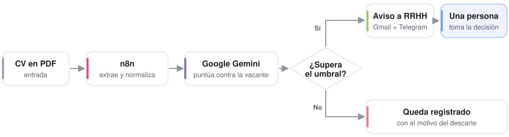

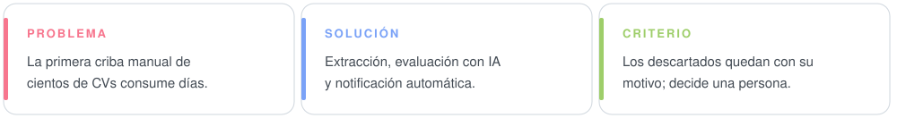

 

<table>
  <tr>
    <td width="50%" valign="top">
      <a href="https://github.com/Eidan210/Frescura-Total-Proyecto-Java">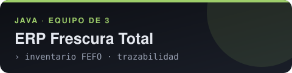</a>
      
ERP de consola para una bodega de alimentos. Me encargué del <b>módulo de inventario</b>: salida FEFO, cuarentena, inspección de calidad, mermas y trazabilidad de lotes.

      
  

      
<a href="https://github.com/Eidan210/Frescura-Total-Proyecto-Java"><b>Código</b></a>

    </td>
    <td width="50%" valign="top">
      <a href="https://github.com/Eidan210/Proyecto-Automatizacion-mym">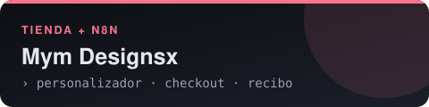</a>
      
Tienda de prendas personalizables: catálogo con filtros, personalizador, carrito con IVA y checkout que envía el recibo al cliente.

      
  

      
<a href="https://github.com/Eidan210/Proyecto-Automatizacion-mym"><b>Código</b></a> &nbsp;·&nbsp; <a href="https://eidan210.github.io/Proyecto-Automatizacion-mym/"><b>Demo ↗</b></a>

    </td>
  </tr>
  <tr>
    <td width="50%" valign="top">
      <a href="https://github.com/Eidan210/portafolio-junior">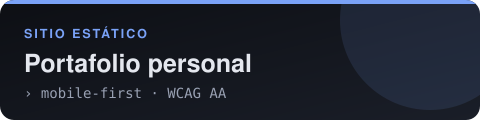</a>
      
Sitio estático sin dependencias ni build, mobile-first y accesible (WCAG AA).

      
  

      
<a href="https://github.com/Eidan210/portafolio-junior"><b>Código</b></a> &nbsp;·&nbsp; <a href="https://eidan210.github.io/portafolio-junior/"><b>Demo ↗</b></a>

    </td>
    <td width="50%" valign="top">
      <a href="https://github.com/Eidan210/Control-De-Apis-JS">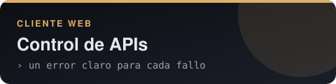</a>
      
Cliente web sobre la API de RAWG con un mensaje de error distinto para cada caso de fallo, en vez de uno genérico.

      
 

      
<a href="https://github.com/Eidan210/Control-De-Apis-JS"><b>Código</b></a>

    </td>
  </tr>
  <tr>
    <td width="50%" valign="top">
      <a href="https://github.com/Eidan210/CampusTech-V2.0-Eidan">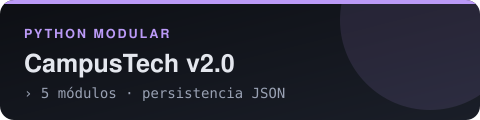</a>
      
Inventario tecnológico en cinco módulos con persistencia en JSON. Reescritura modular de una primera versión monolítica.

      
 

      
<a href="https://github.com/Eidan210/CampusTech-V2.0-Eidan"><b>Código</b></a>

    </td>
    <td width="50%" valign="top">
      <a href="https://github.com/Eidan210/Moneda">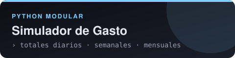</a>
      
Registro de gastos con totales diarios, semanales y mensuales, en seis módulos independientes.

      
 

      
<a href="https://github.com/Eidan210/Moneda"><b>Código</b></a>

    </td>
  </tr>
</table>

 

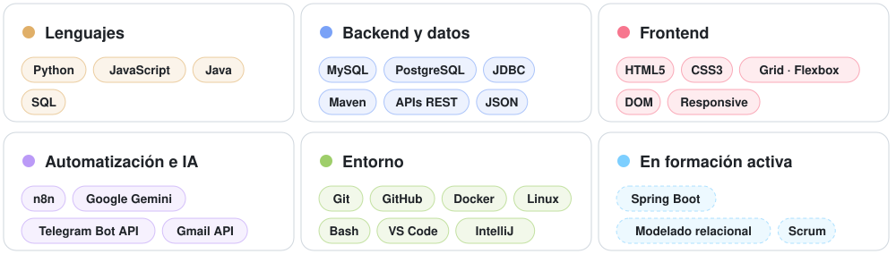

  

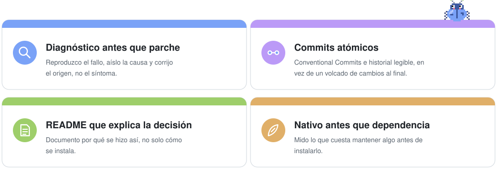

  

 

**El canal más rápido es el correo. Respondo el mismo día.**

 

  

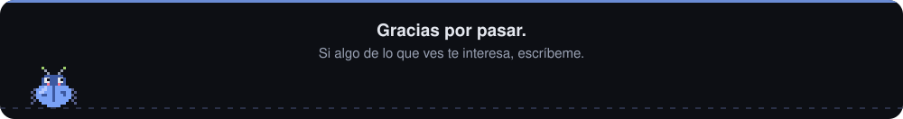

